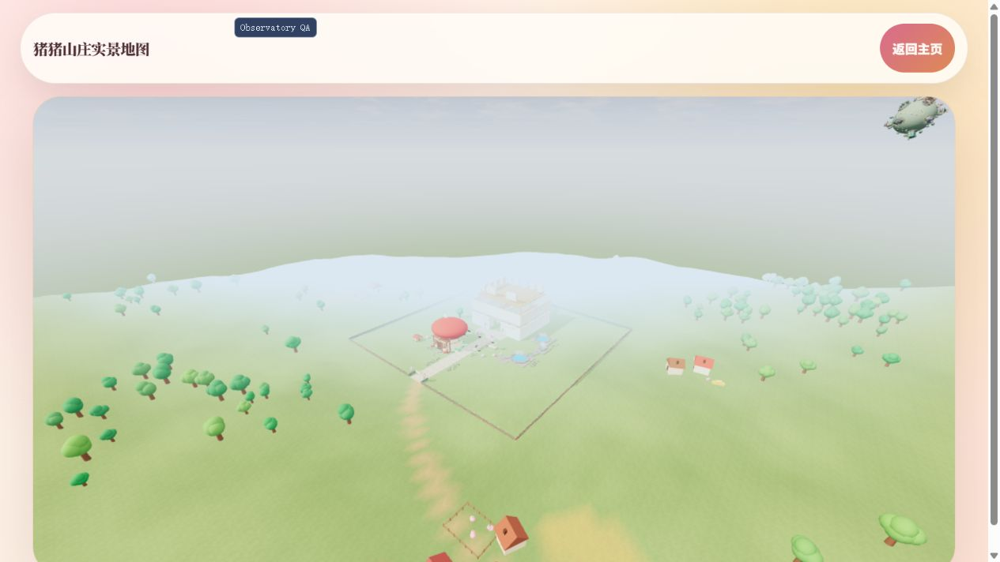
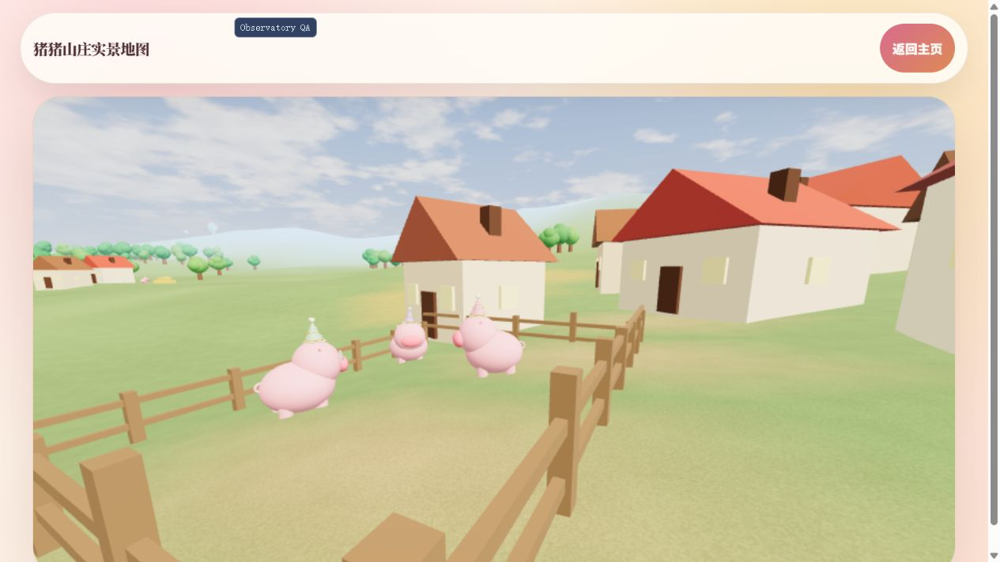

# Village and first-load CPU optimization — 2026-11-01

## Scope and result

The baseline is commit `025c265`. Full-detail village pigs previously rebuilt
thirteen identical procedural models and expanded all of them into one large
world-space buffer. The village now bakes one unchanged vertex-coloured model and
uses 13 instance matrices. Buildings, pens, hay, fields, trees and the sky retain
their existing geometry, placement and materials. The village still uses two draws;
triangle detail is unchanged. No scenery is delayed, hidden, or downloaded.

Resident GLB stand-ins now share plain/microphone geometry templates per material
palette. Every clone retains its own transform and parent, including variant scale
and microphone choice. GLB loading, failure fallback, preparation, entry tracking
and deferred pocket queues are unchanged. Never dispose shared stand-in geometry
or materials during an individual model swap. The WeakMap cache does not retain a
palette after its owning scene becomes unreachable.

## Measurement

Production build, fresh loopback origin per sample, no-store responses, gzip text,
1280x720 / DPR 1.25 / RTX 3080. Three completed 15-second samples before and after,
one 3D tab at a time, without interaction. Birthday content was active. Browser
process, OS file and GPU driver caches remain warm; no CPU or WAN throttling.
The early incomplete baseline sample on port 4370 is excluded. QA-only camera
bookmarks were added after timing collection; the final build passes the same suite.
Raw samples and conditions: `village-startup-2026-11-01.json`.

| Metric, median | Before | After | Reduction |
|---|---:|---:|---:|
| Village synchronous construction | 55.5 ms | 11.1 ms | 80.0% |
| Complete outdoor Scene factory | 117.7 ms | 60.7 ms | 48.4% |
| First canvas callback | 380.6 ms | 309.9 ms | 18.6% |
| Outdoor entry ready marker | 1541.5 ms | 1422.9 ms | 7.7% |
| Blocking proxy before ready | 354 ms | 271 ms | 23.4% |
| Longest task before ready | 183 ms | 136 ms | 25.7% |
| Village pig geometry + instance buffers | 12,826,944 B | 987,520 B | 92.3% |

The 13 pigs now upload 27,408 template vertices rather than 356,304 duplicated
vertices, plus 13 matrices. This is buffer storage, not total renderer memory.
Downloads are essentially unchanged (17,037,060 vs 17,037,274 bytes in this local
server's resource records). This change primarily removes CPU work and duplicate
GPU buffers; it does not reduce model download sizes or per-frame triangle counts.
Ready still means 37 outdoor entry swaps complete plus the next frame opportunity,
excluding the existing 700 ms veil fade. Blocking proxy sums max(task - 50 ms, 0)
and is not Lighthouse TBT. First callback is not GPU presentation. Three samples
show the local direction of improvement, not confidence intervals or low-end FPS.

## Fidelity and regression checks

- 580 tests pass; production build passes.
- Buildings' position, normal and colour buffers match baseline SHA-256 exactly.
- Tests compare every pig instance's world-space vertices, normals and colours
  against the unchanged procedural source; positions differ by less than 0.01 mm.
- Count, placement, bounding sphere/box, roughness, shadow flags and the original
  two-draw budget remain pinned; downward ray hits still find all terrain anchors.
- Stand-in tests cover shared geometry, independent transforms, microphone variants,
  palette isolation and the deferred loader's scale/placeholder contract.
- The existing query-only harness now includes `village-hamlet`, `village-pigs` and
  `village-pigs-side` bookmarks for repeatable visual review, with no ordinary-visit
  camera change. Use `observatory=test&lights=on&mapquality=minimum` for these fixed cameras.
  Outside the walkable bounds, perf mode walking controls return camera height to
  the world ground plane and cannot be used for hill-level close-up acceptance.

## Reproduce

Run `npm test`, `npm run build`, then
`node scripts/startup-audit-server.mjs 4370 8`. Visit a fresh origin's
`/villa-map/?startup=measure` for each sample and wait for `final:true`.
Use the current and baseline builds in sequence; do not run both scenes at once.
The methodology and milestone limitations also apply to `STARTUP.md`.

## Visual evidence

The same `fence-overview` camera at Low preserves the village, fields and tree line.
These are deterministic test-mode overview frames, not a measurement of fully
streamed villa interiors. Minimum close-up views also retain full-detail pigs,
cottages, pens and birthday hats. The close-up is a QA camera outside the player
bounds; the public exploration boundary remains unchanged.

Final live Minimum validation: 37/37 outdoor entry loads complete with zero
failures; the pocket remains uncreated outdoors. First pocket entry reaches
139/139, zero remaining placeholders/fallbacks and zero failed loads. Returning
outdoors and re-entering preserves the same 139 total loads, with no pending work.
All 37 birthday hats (24 residents + 13 villagers) remain present. The room was
visually inspected after model swaps. Browser error logs were empty.
